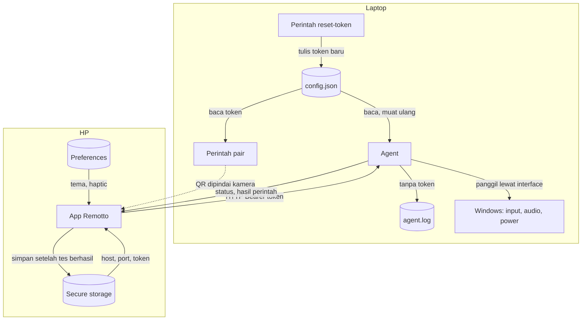
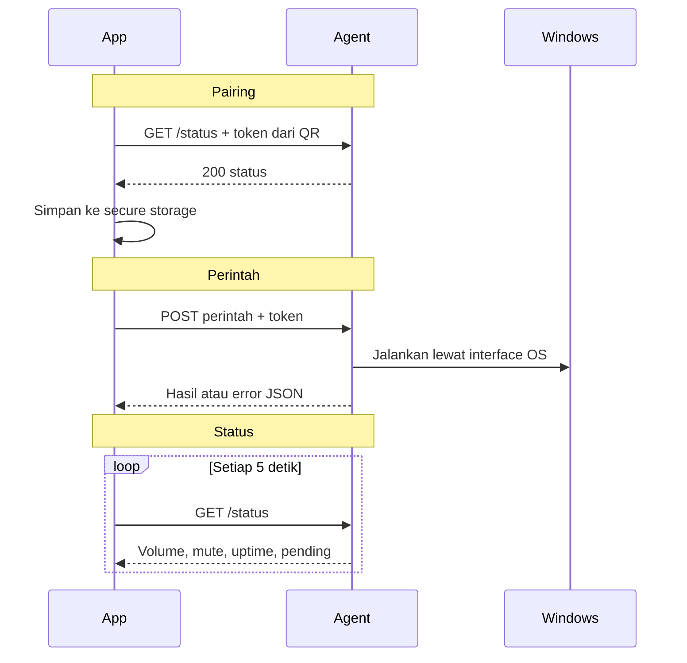

# Data Design — Remotto

Status dokumen: **Gate 1, revisi setelah keputusan selisih desain**. Bentuk respons API ada di `docs/api-spec.md` (Gate 2). Aturan bisnis `BR-n` ada di `docs/prd.md`.

## 1. Kenapa tanpa database

Data Remotto hanya satu set konfigurasi, satu token, dan preferensi tampilan. Tidak ada relasi, riwayat, atau query. Database akan menambah dependency dan proses migrasi tanpa manfaat. Agent cukup memakai satu file JSON dan file log; app cukup memakai secure storage dan preferences.

## 2. Peta penyimpanan

| Data | Lokasi | Umur | Sensitif |
|---|---|---|---|
| Config agent, termasuk token | `%APPDATA%\Remotto\config.json` | Permanen | Ya |
| Log agent | `%APPDATA%\Remotto\logs\agent.log` + hasil rotasi | Dirotasi berdasarkan ukuran | Rendah, tanpa token |
| Jadwal daya aktif, cache volume | Memori agent | Selama proses hidup | Tidak |
| Host, port, token, nama laptop, agentId | Secure storage HP | Sampai pairing diganti | Ya |
| Tema, haptic | Preferences HP | Permanen | Tidak |
| Perintah daya terakhir (`lastPowerCommand`) | Preferences HP | Sampai laptop tersambung lagi | Tidak |
| State layar, nilai volume terakhir | Memori app | Selama app hidup | Tidak |

## 3. Config agent

**Path final:** `%APPDATA%\Remotto\config.json`. Folder yang sama dipakai untuk log, sehingga hanya ada satu tempat untuk diperiksa.

### Field

| Field | Tipe | Default | Keterangan |
|---|---|---|---|
| `configVersion` | int | `1` | Versi skema file |
| `laptopName` | string | hostname Windows | 1–64 karakter, tampil di app |
| `port` | int | `8765` | 1024–65535 |
| `bindAddress` | string | `0.0.0.0` | Alasan di `docs/technical-spec.md` bagian 11 |
| `agentId` | string | dibuat saat first run atau saat kosong | 32 karakter hex huruf kecil (128 bit), dari `crypto/rand`; publik, lihat `docs/api-spec.md` |
| `token` | string | dibuat saat first run | 64 karakter hex huruf kecil (256 bit) |
| `tokenCreatedAt` | string | waktu pembuatan | RFC 3339 |
| `createdAt` | string | waktu first run | RFC 3339 |
| `powerDelaySeconds` | int | `5` | 5–30; di bawah 5 ditolak |
| `rateLimit.requestsPerSecond` | int | `20` | Per IP; harus di atas laju slider (10 per detik) |
| `rateLimit.burst` | int | `40` | Toleransi lonjakan |
| `logLevel` | string | `info` | `debug`, `info`, `warn`, `error` |
| `discovery.enabled` | bool | `true` | Mengatur iklan mDNS. `false` berarti agent tidak mengiklankan diri, dan app harus memakai scan QR ulang |

Desain hitung mundur mengasumsikan 5 detik, termasuk 5 segmen di mode reduced motion. Nilai `powerDelaySeconds` selain 5 boleh untuk agent, tapi tidak dijamin rapi di app.

### `agentId` dan discovery

- `agentId` adalah identitas agent, bukan rahasia. Nilainya ada di TXT mDNS dan di respons `GET /status`.
- Dibuat saat first run. Kalau field ini kosong atau hilang (config dari versi sebelum M7), agent membuatnya lalu menyimpannya secara atomik.
- `reset-token` **tidak** mengubah `agentId`. Dengan begitu app tahu laptop yang sama, sedangkan tokennya sudah basi.
- `configVersion` tetap `1`. Field yang hilang diisi default: `agentId` kosong, `discovery.enabled` `true`.
- Iklan mDNS tidak pernah berisi token atau hash token. Detail iklan ada di `docs/api-spec.md` bagian Discovery.

### Kenapa token disimpan apa adanya, bukan hash

`pair` harus bisa menampilkan QR yang sama kapan pun, misalnya untuk HP kedua, tanpa membuat pairing lama batal. Hash membuat hal itu mustahil, karena setiap pairing berarti reset token. Pelindungnya adalah izin file. Siapa pun yang sudah bisa membaca file sebagai user tersebut juga sudah bisa mengendalikan laptop secara langsung, jadi hash tidak menambah perlindungan yang berarti.

### Format token

Token berupa 64 karakter hex huruf kecil. Dipilih karena input manual (Q06) mungkin diketik atau ditempel: tidak ada karakter yang mirip seperti `l`/`I`/`O`/`0` campur kapital, dan app bisa menormalkan input ke huruf kecil serta membuang spasi.

### Izin file

- Folder dan file diberi DACL khusus milik user pemilik, tanpa pewarisan dari folder induk.
- Agent memeriksa izin saat start. Kalau longgar, agent memperbaikinya dan mencatat peringatan.
- Berlaku juga untuk semua file cadangan, karena isinya sama-sama berisi token.

### Aturan tulis

- Tulis atomik: file sementara di folder yang sama dengan izin yang sudah benar, lalu rename.
- Yang menulis hanya first run, `reset-token`, dan migrasi.

### Perilaku reset token saat agent berjalan

`reset-token` adalah proses terpisah dari agent yang sedang berjalan, sementara BR-10 meminta token lama langsung mati. Karena itu middleware auth memeriksa waktu modifikasi `config.json` di setiap request dan memuat ulang token bila berubah. Biayanya kecil dan tidak perlu mekanisme IPC.

### Migrasi versi

1. `configVersion` lebih kecil → migrasi berurutan per versi; simpan salinan `config.json.v<N>.bak` dulu.
2. `configVersion` sama → pakai apa adanya; field yang hilang diisi default, field tak dikenal dibiarkan.
3. `configVersion` lebih besar dari yang dikenal agent → agent menolak start dengan pesan jelas, file tidak disentuh.

### File rusak atau hilang

| Kondisi | Perilaku |
|---|---|
| File hilang | Dianggap first run: buat config dan token baru. App lama menerima 401 → pairing ulang |
| JSON rusak | File diganti nama menjadi `config.json.corrupt`, config baru dibuat, peringatan dicatat. Agent tetap hidup walau dijalankan otomatis, dan app menerima 401 → pairing ulang |
| Nilai di luar rentang | Agent menolak start dengan pesan yang menyebut field-nya |
| Tidak bisa menulis | Agent menolak start, karena token tidak bisa dijamin tersimpan |

Keadaan rusak selalu berakhir dengan token baru, sehingga tidak pernah gagal terbuka.

## 4. Log agent

- **Lokasi:** `%APPDATA%\Remotto\logs\agent.log`.
- **Format:** JSON per baris lewat `log/slog`. Saat `run` interaktif, log juga tampil di konsol.
- **Rotasi:** berdasarkan ukuran, 5 MiB per file, simpan 3 file lama. Kebijakan ini cukup untuk diagnosis dan tidak butuh tugas pembersihan terjadwal.

| Field | Contoh | Keterangan |
|---|---|---|
| `time` | RFC 3339 | Waktu kejadian |
| `level` | `info` | |
| `msg` | `request` | |
| `ip` | `192.168.1.20` | Alamat klien |
| `method` | `POST` | |
| `path` | `/api/v1/media/next` | Path saja, tanpa query |
| `status` | `200` | Kode respons |
| `errorCode` | `invalid_token` | Hanya saat gagal |
| `durationMs` | `4` | Durasi proses |

**Dilarang ditulis:** nilai token, header `Authorization`, isi body request, query string, dan isi `config.json`. Percobaan token salah dicatat dengan IP dan `errorCode`, tanpa nilai token. Output `pair` tidak masuk log.

## 5. Payload QR pairing

Payload berupa JSON satu baris. Format ini mengikuti brief dan menggantikan asumsi `remotto://…` di `design/scope-and-flows.md`.

| Field | Tipe | Aturan |
|---|---|---|
| `v` | int | Versi skema, saat ini `1` |
| `name` | string | Nama laptop, 1–64 karakter; `pair` memotongnya ke 32 agar QR tetap kecil |
| `host` | string | IPv4 |
| `port` | int | 1–65535 |
| `token` | string | Cocok dengan `^[0-9a-f]{64}$` |
| `id` | string | Opsional. Bila ada, cocok dengan `^[0-9a-f]{32}$` (`agentId`). QR tanpa `id` (sebelum M7) tetap valid |

Contoh bentuk (token dan id diganti teks contoh):

```json
{"v":1,"id":"<32-hex>","name":"Laptop Kamar","host":"192.168.1.10","port":8765,"token":"<64-hex>"}
```

**Ukuran:** sekitar 180 byte, paling banyak sekitar 210 byte (dengan `id` dan nama 32 karakter). Ukuran ini di bawah batas 256 byte validasi app dan tetap bisa dipindai dari terminal.

**Pemilihan host saat `pair`:** adapter aktif dengan default gateway dan IPv4 privat, sehingga adapter virtual seperti WSL atau Hyper-V terlewati. Opsi `--host` tersedia untuk override, misalnya untuk IP Tailscale. Host tetap IP. Saat IP berubah karena ganti WiFi, app menemukan alamat baru lewat discovery mDNS tanpa scan QR ulang. Scan QR ulang hanya dibutuhkan untuk pairing awal atau kalau discovery tidak menemukan laptop.

### Validasi di app

Isi QR diperlakukan sebagai input tidak tepercaya. Ketentuan berikut berlaku juga untuk input manual (kecuali field `v` dan `name`).

1. Teks QR maksimal 256 byte dan berupa objek JSON.
2. `v` harus `1`.
3. Semua field wajib ada dengan tipe dan format yang benar. Field tak dikenal diabaikan.
4. `host` harus IPv4 di rentang privat (`10.0.0.0/8`, `172.16.0.0/12`, `192.168.0.0/16`) atau rentang Tailscale (`100.64.0.0/10`) sesuai BR-12.
5. `id` opsional. Bila ada tetapi tidak cocok `^[0-9a-f]{32}$`, QR ditolak dengan Q04. Input manual tidak punya `id`, sehingga agentId diambil dari `/status` saat tes koneksi.
6. Gagal validasi → Q04 untuk QR, Q07 untuk input manual. Isi QR tidak dicatat ke log app.

Data baru disimpan hanya setelah tes `GET /status` berhasil, dan `name` di penyimpanan diperbarui dari respons `/status`. Bila QR membawa `id` dan `agentId` dari `/status` berbeda, pairing ditolak lewat jalur Q10 yang sudah ada dan tidak ada yang disimpan. `agentId` dari `/status` disimpan bersama host, port, dan token.

## 6. Penyimpanan app

### Secure storage (`flutter_secure_storage`)

| Key | Isi |
|---|---|
| `remotto.host` | IPv4 laptop |
| `remotto.port` | Port |
| `remotto.token` | Token |
| `remotto.laptopName` | Nama laptop |
| `remotto.agentId` | `agentId` laptop, opsional |

Keempat key wajib dibaca sebagai satu kesatuan. Kalau salah satu hilang, semuanya dianggap tidak ada dan app ke Q01.

`remotto.agentId` tidak ikut aturan itu. Key ini bersifat opsional: kalau hilang, pairing tetap dianggap ada (legacy, sebelum M7), tapi discovery nonaktif sampai `agentId` terisi lewat backfill.

### Preferences (`shared_preferences`)

| Key | Nilai | Default |
|---|---|---|
| `themeMode` | `system`, `light`, `dark` | `system` |
| `hapticEnabled` | boolean | `true` |
| `lastPowerCommand` | objek `{action, sentAt}` atau tidak ada | tidak ada |

### Perilaku saat data hilang

| Kondisi | Perilaku |
|---|---|
| Secure storage kosong (install baru, data dihapus) | Mulai dari Q01 |
| Secure storage gagal dibaca | Diperlakukan sebagai kosong → Q01, tidak crash |
| Preferences hilang | Kembali ke default; tanpa `lastPowerCommand`, offline tampil sebagai S10 biasa |
| App di-install ulang di iOS, Keychain masih ada | Sambungan lama terbaca; kalau token sudah basi, 401 → Q12 |
| `agentId` hilang (pairing sebelum M7) | Sambungan tetap dipakai. Discovery nonaktif. `agentId` diisi saat `GET /status` berikutnya berhasil dengan token tersimpan (backfill) |
| 401 dari agent | Data dipertahankan sampai pairing baru berhasil (BR-9) |
| Pairing ulang dari Pengaturan | Keempat key dihapus setelah konfirmasi R04 |

`lastPowerCommand` membedakan "laptop lagi mati" (P15) dari "nggak kejangkau" (S10). Nilai ini ditulis saat perintah daya berhasil dijadwalkan, dihapus saat laptop tersambung lagi atau saat jadwal dibatalkan, dan berlaku maksimal 10 menit. `sentAt` memakai jam HP dan hanya dibandingkan dengan jam HP.

Tema dan haptic tidak ikut terhapus saat pairing ulang karena bukan bagian dari sambungan, sedangkan `lastPowerCommand` ikut dihapus. Backup otomatis Android untuk data sambungan dimatikan; detailnya di Gate 2.

## 7. State runtime agent

| State | Isi | Hilang saat restart | Kenapa aman |
|---|---|---|---|
| Jadwal daya aktif (`pending`) | Aksi, waktu dijadwalkan, waktu eksekusi, sedang dieksekusi atau tidak | Ya | Laptop tidak jadi mati/sleep, arah gagal yang aman. App melihat jadwal hilang di `/status` |
| Token di memori | Salinan dari config | Dimuat ulang | Sumbernya tetap file |
| Waktu modifikasi config | Pemicu muat ulang | Dibaca ulang | Tidak ada data yang hilang |
| Cache volume | Level + mute terakhir | Ya | Dibaca ulang dari Core Audio |
| Status rate limit | Hitungan per IP | Ya | Hanya menyetel ulang batas |

Jadwal daya sengaja **tidak** dipersistenkan: jadwal yang hidup lagi setelah restart berisiko mematikan laptop tanpa diminta.

`pending` tetap terlihat dengan sisa 0 selama perintah OS dieksekusi, supaya app bisa menampilkan P14 dan tidak menawarkan Batal yang sudah tidak mungkin berhasil. Cancel pada tahap ini ditolak dengan 409. `pending` dibersihkan begitu pemanggilan OS kembali, baik gagal maupun setelah laptop bangun dari sleep, sehingga `/status` tidak menampilkan jadwal basi.

App menghitung sisa dari `remainingMs`, bukan dari `scheduledAt`, karena jam laptop dan HP bisa berbeda.

## 8. Aliran data




