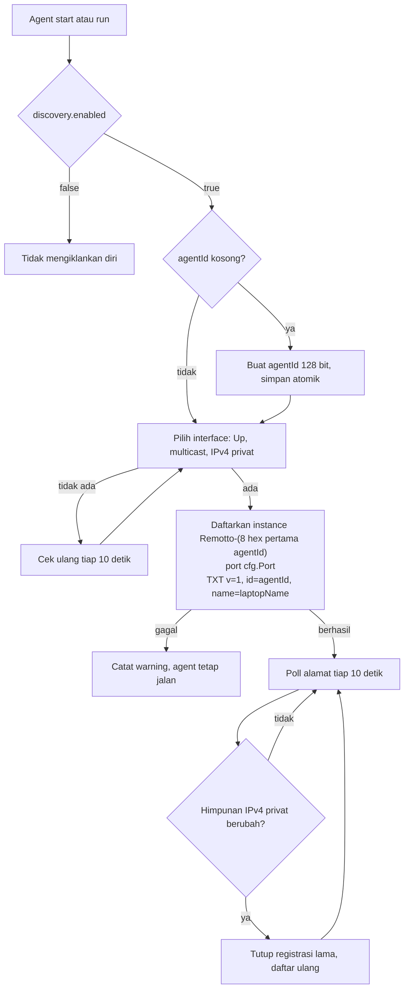
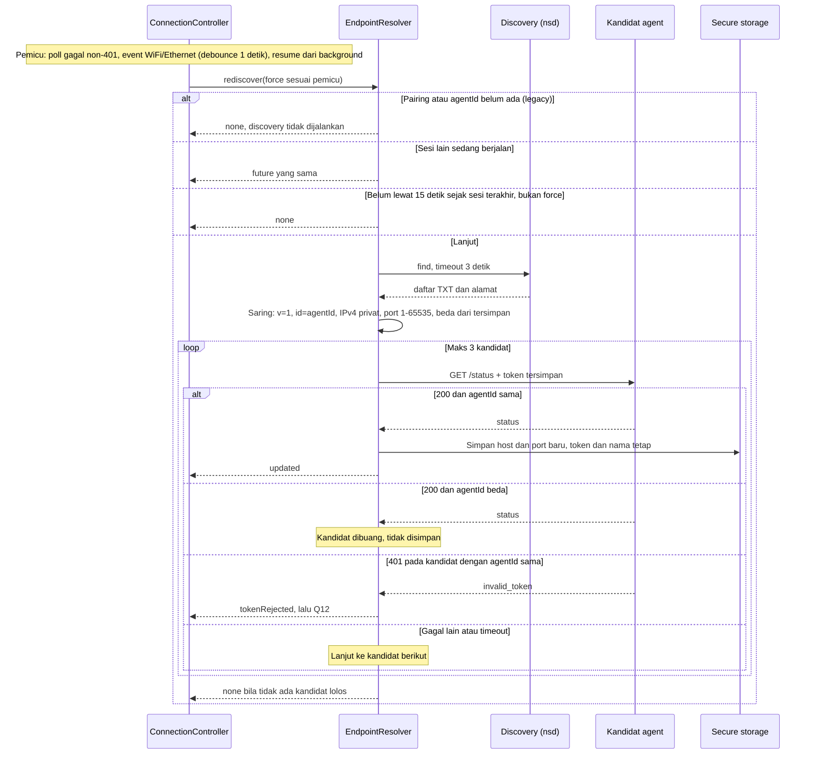

# Discovery Flow (mDNS)

Discovery membuat app menemukan laptop lagi setelah IP berubah, misalnya saat ganti WiFi, tanpa scan QR ulang dan tanpa restart app. Syarat: HP dan laptop berada di WiFi/LAN yang sama. Token tetap wajib dan tidak pernah dikirim ke kandidat yang belum terverifikasi.

Aturan dasar:

- Hanya mDNS/DNS-SD (`_remotto._tcp`). Tidak ada UDP broadcast dan tidak ada sweep subnet.
- Port tidak berubah. Yang berubah hanya IP.
- Discovery tidak membuat endpoint HTTP baru. Verifikasi memakai `GET /status` biasa.
- Discovery nonaktif sampai `agentId` tersimpan di app (pairing lama, lihat `docs/data-design.md`).

## Iklan di agent

Catatan:

- Token dan hash token tidak pernah masuk TXT.
- Iklan hanya di interface privat. WSL, Hyper-V, dan Tailscale dikecualikan.
- Kegagalan iklan tidak menghentikan agent. Route HTTP tetap berjalan, dan app bisa memakai scan QR ulang.

## Rediscover di app

Rediscover hanya berjalan saat RemoteScreen aktif (saat polling berjalan). Pemicunya ada empat, dan satu aturan membatasi jalur lainnya.

Akibat tiap hasil:

| Hasil | Tindakan controller |
|---|---|
| `updated` | `_failures` direset, poll langsung ke host baru. Fase tetap online, atau pindah dari offline ke back |
| `none` | Fase tidak berubah. Offline tetap offline dan polling berikutnya mencoba lagi |
| `tokenRejected` | Masuk Q12 (BR-9). Polling dan resume berhenti. Data lama dipertahankan sampai pairing baru berhasil |

## Cabang khusus

**agentId beda.** Ada laptop lain di WiFi yang sama, atau laptop yang sama sudah diganti config-nya. Kandidat dengan TXT `id` yang tidak cocok dengan `agentId` tersimpan dibuang sebelum dihubungi, dan endpoint tersimpan tidak berubah. Kandidat yang lolos filter TXT dihubungi dengan token tersimpan, lalu `agentId` di respons `/status` dicek. Bila berbeda, kandidat dibuang dan tidak ada yang disimpan. Risiko kandidat palsu yang menyalin TXT lalu menerima Bearer diterima dan dicatat sebagai R-19.

**401.** Pada kandidat dengan `agentId` yang cocok, 401 berarti token sudah di-reset (`reset-token`). Ini sama dengan 401 dari endpoint biasa: app masuk Q12. Tidak ada yang disimpan.

**Tidak ketemu.** Discovery kosong, alamat privat tidak ada, atau mDNS diblokir router atau firewall (UDP 5353 tidak diizinkan). Ini bukan error. State offline tetap tampil sebagai S10. Pemilik bisa memakai scan QR ulang lewat alur pairing (Q01).

**Hanya seluler.** Jaringan aktif bukan WiFi atau Ethernet. Rediscover dilewati, karena laptop tidak mungkin satu LAN.

**Legacy.** Pairing tanpa `agentId` tidak memakai discovery. Backfill terjadi di `_onSuccess`: setelah `GET /status` berhasil dengan token dan respons memuat `agentId`, app menyimpannya. Sesudah itu discovery aktif.

## Batas yang disengaja

- `agentId` bersifat publik. Perangkat jahat di LAN bisa menyalin TXT lalu menerima Bearer saat verifikasi. Risiko ini setara dengan R-6 dan dicatat sebagai R-19 di `docs/prd.md`. Penguatan (TLS atau challenge-response) masuk backlog.
- Discovery tidak berjalan di background. Pemicu hanya dari layar aktif, resume, dan event jaringan.
