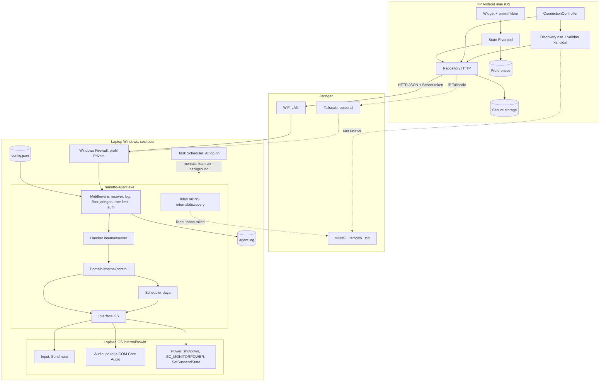

# System Architecture

## Catatan

- Agent dan app hanya berkomunikasi lewat HTTP; tidak ada komponen lain.
- `internal/control` tidak mengetahui Windows. Implementasi OS hanya di `internal/oswin`.
- Task Scheduler menjalankan agent di sesi user, karena session 0 tidak bisa mengirim media key.
- Tailscale opsional dan tanpa perubahan kode. Port agent tidak pernah di-forward ke internet.
- Discovery hanya mDNS di LAN. Iklan tidak pernah memuat token; alur lengkap ada di `docs/flows/discovery-flow.md`.
- `pair` dan `reset-token` adalah proses terpisah yang membaca atau menulis `config.json`. Agent yang berjalan mendeteksi perubahan token lewat waktu modifikasi file.
