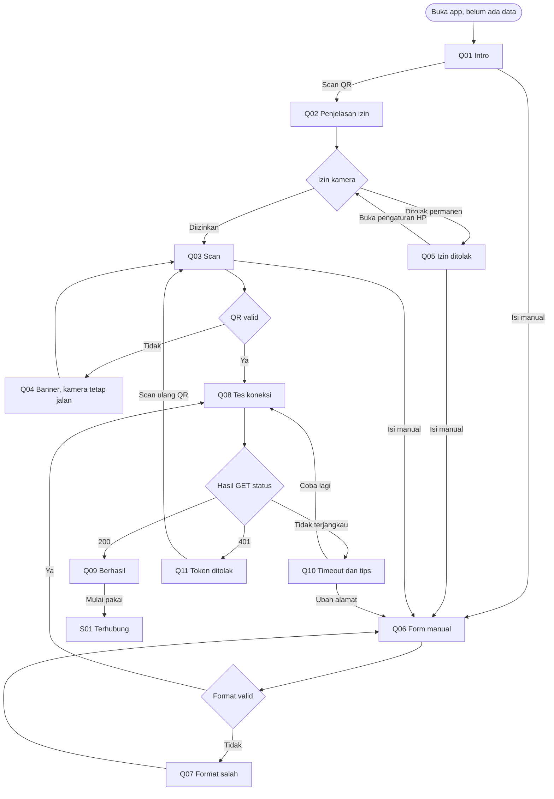
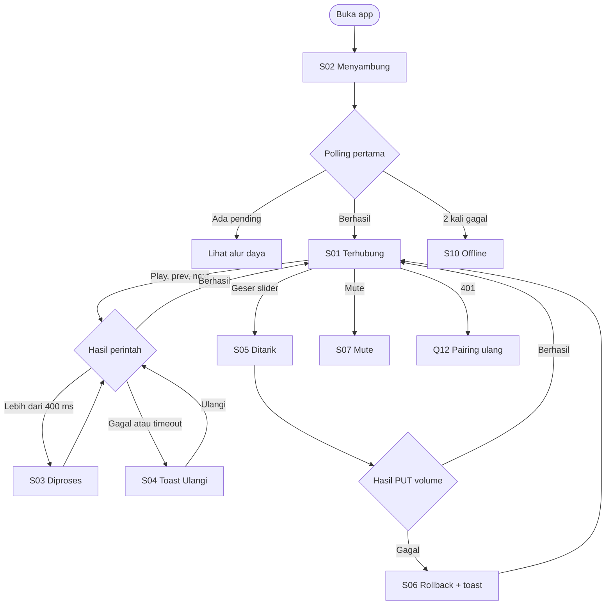
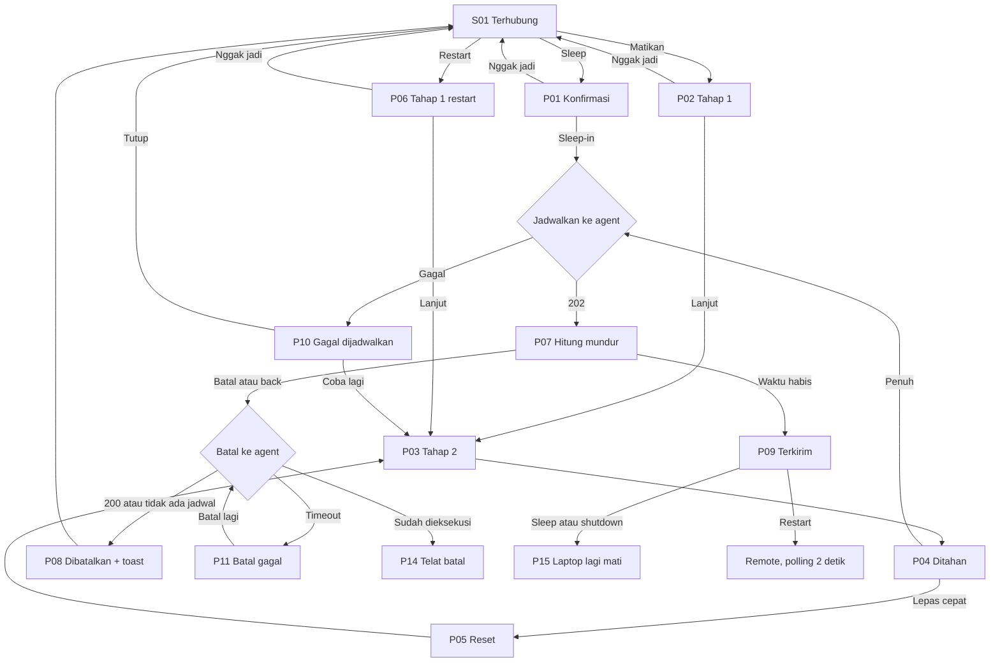
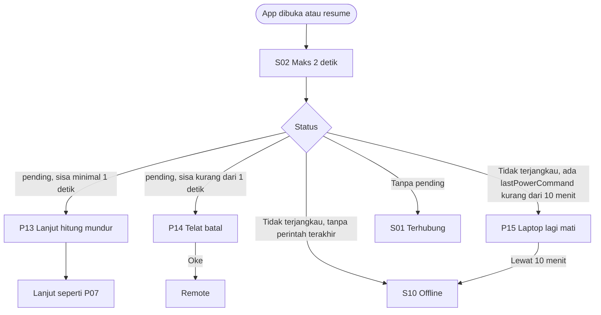
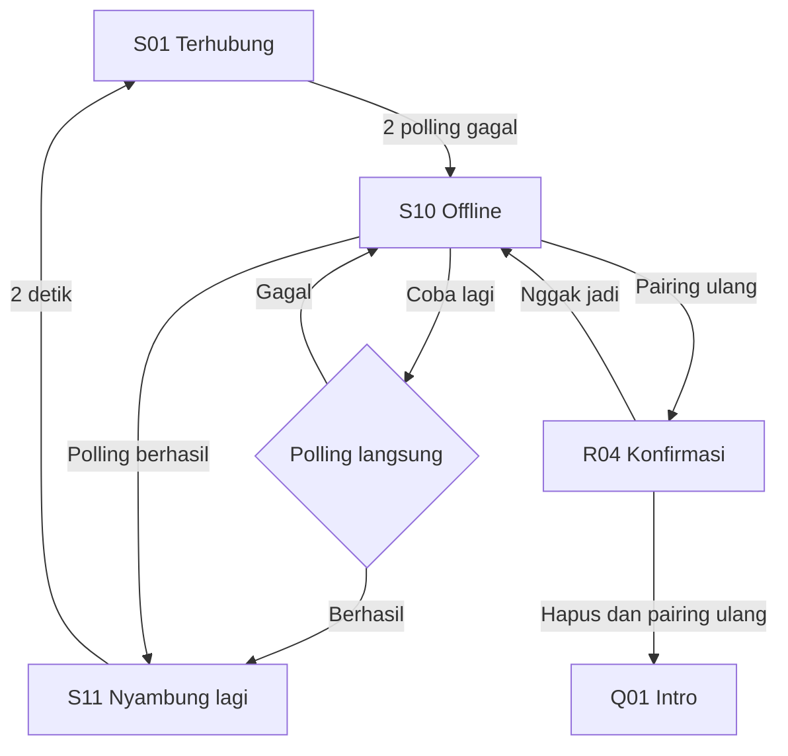
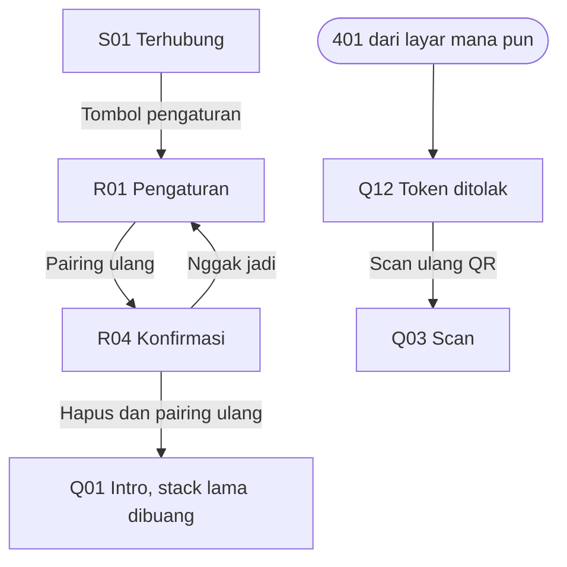

# User Flow

Screen dan state merujuk `design/screens.md`.

## Pairing pertama

## Pakai harian

## Daya, dengan batal

## App dibuka saat perintah daya berjalan

## Offline ke online

## Pairing ulang

