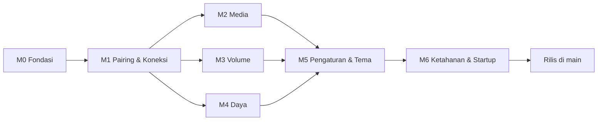

# PRD — Remotto

Remote pribadi untuk laptop Windows lewat WiFi yang sama. Nama repo: `laptop-remote`.

Sumber tampilan: folder `design/`. Dokumen ini memakai ID screen dan state dari `design/screens.md` (mis. SCR-010, S10, P07) dan ID komponen dari `design/components.md` (mis. C12).

Status dokumen: **Gate 1, revisi setelah keputusan selisih desain**. Rincian keputusan ada di bagian 13.

---

## 1. Executive summary

Remotto terdiri dari dua program: **agent** kecil berbahasa Go yang jalan di laptop Windows, dan **app** Flutter di HP. App mengirim perintah lewat HTTP di jaringan lokal, agent menjalankannya di level OS: media key, volume, dan daya.

Produk ini dipakai satu orang, tanpa akun dan tanpa cloud. Karena agent bisa mematikan laptop, keamanan token dan pengaman perintah daya adalah fitur inti.

## 2. Problem statement & background

Pemilik sering memutar lagu atau video di laptop (Brave, Spotify) sambil berada jauh dari laptop, biasanya rebahan. Tiga hal yang menjengkelkan:

1. Harus bangun hanya untuk play/pause.
2. Harus bangun untuk naik/turun volume atau mute.
3. Harus bangun untuk sleep atau shutdown. Kalau dibuat bisa dari HP, aksi ini tidak boleh terjadi karena kepencet.

Selain jadi alat pakai sendiri, proyek ini adalah portofolio app native Flutter dan integrasi OS level rendah di Go.

## 3. Goals & success metrics

Semua metrik bisa dicek langsung, baik dari kode, test, maupun pemakaian.

| ID | Goal | Metrik | Cara cek |
|---|---|---|---|
| G-1 | Media instan | Play/pause, next, prev = satu ketukan dari Remote, tanpa dialog dan tanpa scroll | Review flow + widget test |
| G-2 | Volume instan | Volume berubah lewat slider atau −/+ langsung dari Remote; persen selalu tampil | Widget test |
| G-3 | Respons agent | Agent memproses perintah media/volume < 100 ms di luar latensi jaringan | Test durasi handler dengan fake OS; log `durationMs` |
| G-4 | Daya aman | Shutdown/restart butuh minimal dua konfirmasi dan tahan 1,2 detik; satu ketukan tidak pernah cukup | Widget test + test BR-6 |
| G-5 | Daya bisa dibatalkan | Semua perintah daya punya jeda 5 detik yang bisa dibatalkan | Test scheduler |
| G-6 | Status jelas | Status terhubung, menyambung, offline selalu tampil dengan ikon + teks | Widget test S01, S02, S10 |
| G-7 | Akses terlindungi | 100% endpoint menolak request tanpa token valid | Test handler yang menelusuri semua route |
| G-8 | Tidak generik | Tidak ada package UI kit; tidak ada widget default Material yang terlihat | Cek `pubspec.yaml` + checklist review |

## 4. Persona

**Pemilik.** Developer yang memakai satu laptop Windows dan satu sampai dua HP miliknya sendiri. Memakai app dengan satu tangan, sering di kamar gelap, tanpa mau membaca layar lama-lama. Nyaman menjalankan perintah terminal sekali saat instalasi.

## 5. Scope per modul

Urutan sudah mengikuti dependency.

| Modul | Isi | Bobot | Bergantung pada |
|---|---|---|---|
| M0 Fondasi Proyek | Monorepo `agent/` + `app/`, tooling lint/format/test, CI, tema & token di Flutter, kerangka navigasi, kerangka server agent | sedang | — |
| M1 Pairing & Koneksi | Token, QR pairing, `GET /status`, middleware token, log akses; layar pairing, tes koneksi, secure storage, polling status, indikator koneksi, penanganan token ditolak | besar | M0 |
| M2 Kontrol Media | Play/pause, next, prev; tombol tactile dengan haptic | kecil | M1 |
| M3 Volume | Get/set level 0–100, mute, naik/turun; slider kustom, persen, throttle, sinkron | sedang | M1 |
| M4 Daya | Sleep, restart, shutdown dengan jeda 5 detik, cancel, status jadwal; konfirmasi, hitung mundur, hasil | sedang | M1 |
| M5 Pengaturan & Tema | Info laptop, pairing ulang, tema, haptic, versi; perintah `reset-token` | kecil | M1 |
| M6 Ketahanan & Startup | Task Scheduler, rate limit, graceful shutdown, rotasi log; auto-reconnect, kembali dari background, timeout konsisten | sedang | M1–M5 |
| M7 Auto-Discovery Jaringan | mDNS: agent mengiklankan diri, app menemukan IP baru saat ganti WiFi tanpa scan QR ulang; `agentId`; validasi kandidat | sedang | M1, M6 |

## 6. Out of scope

- Agent untuk macOS/Linux, multi-laptop di satu app, multi-user/akun, tablet/landscape.
- Now playing, Wake-on-LAN, widget homescreen, jadwal shutdown. Semuanya stretch di backlog.
- Kontrol per aplikasi (khusus Brave atau khusus Spotify). Play/pause memakai media key global, jadi yang kena adalah sesi media aktif Windows.
- Memaksa sleep yang berubah jadi hibernate di laptop S3 lewat kode. Solusinya didokumentasikan (`powercfg -h off`).
- Windows Service. Service jalan di session 0 dan tidak bisa mengirim media key.
- Tampilan agent di laptop, selain output terminal.
- Layar atau baris lisensi di Pengaturan. Berkas lisensi font tetap ikut dibundel sebagai aset.
- Notifikasi lokal selama hitung mundur saat app di background.
- Distribusi Play Store/App Store. Install lewat APK atau `flutter run`.
- Akses dari luar rumah sebagai fitur app. Tailscale tetap bisa dipakai tanpa perubahan kode, cukup didokumentasikan.

## 7. Model akses

Hanya ada satu pemilik. Otorisasi = punya token valid atau tidak. Tabel berikut menggantikan permission matrix.

| Aksi | Token valid | Agent online | Jadwal daya aktif | Hasil bila syarat tidak terpenuhi |
|---|---|---|---|---|
| Baca status | wajib | wajib | boleh | 401 / offline |
| Media | wajib | wajib | boleh | 401 / kontrol nonaktif |
| Baca atau ubah volume, mute | wajib | wajib | boleh | 401 / kontrol nonaktif |
| Jadwalkan sleep/restart/shutdown | wajib | wajib | harus tidak ada | 401 / kontrol nonaktif / 409 |
| Batalkan jadwal | wajib | wajib | harus ada | 401 / P11 / 409 |
| Pairing dari app | token diuji saat pairing | wajib | boleh | Q10 / Q11 |
| `pair`, `reset-token`, `install-startup` di laptop | akses terminal user laptop | tidak perlu | boleh | — |

Selama hitung mundur, kontrol media dan volume di agent tetap diizinkan. Di app, kontrol tersebut tertutup oleh layar hitung mundur.

## 8. User stories

**M1 Pairing & Koneksi**
- US-1.1: Sebagai pemilik, saya scan QR dari terminal laptop supaya HP tersambung tanpa mengetik.
- US-1.2: Saya bisa mengisi alamat dan token manual kalau kamera tidak tersedia atau izin ditolak.
- US-1.3: Saya tahu laptop sedang tersambung, menyambung, atau tidak terjangkau tanpa perlu menekan apa pun.
- US-1.4: Kalau token sudah tidak berlaku, saya langsung diarahkan untuk pairing ulang.

**M2 Kontrol Media**
- US-2.1: Saya menekan play/pause sekali dari kasur dan lagu berhenti atau jalan.
- US-2.2: Saya bisa pindah lagu berikut atau sebelumnya.
- US-2.3: Kalau perintah gagal terkirim, saya diberi tahu dan bisa mengulang.

**M3 Volume**
- US-3.1: Saya menggeser slider dan volume laptop mengikuti.
- US-3.2: Saya menekan −/+ untuk mengubah volume sedikit demi sedikit.
- US-3.3: Saya bisa mute dan unmute.
- US-3.4: Angka di HP sama dengan volume laptop, termasuk kalau diubah dari laptop.

**M4 Daya**
- US-4.1: Saya menidurkan laptop dari HP dengan satu konfirmasi.
- US-4.2: Saya mematikan atau me-restart laptop dengan konfirmasi berlapis, sehingga tidak mungkin kepencet.
- US-4.3: Saya punya kesempatan membatalkan selama hitung mundur.
- US-4.4: Kalau pembatalan gagal, saya diberi tahu dengan jelas dan bisa mencoba lagi.

**M5 Pengaturan & Tema**
- US-5.1: Saya melihat laptop mana yang tersambung.
- US-5.2: Saya memilih tema Terang, Gelap, atau Ikuti sistem.
- US-5.3: Saya menyalakan atau mematikan getar.
- US-5.4: Saya bisa pairing ulang dari Pengaturan.
- US-5.5: Kalau HP hilang, saya menjalankan `reset-token` di laptop dan HP itu langsung kehilangan akses.

**M6 Ketahanan & Startup**
- US-6.1: Agent jalan sendiri setelah saya login ke Windows.
- US-6.2: App tersambung lagi sendiri setelah WiFi putus atau app kembali dari background.
- US-6.3: Satu perintah yang gagal tidak mematikan agent.

**M7 Auto-Discovery Jaringan**
- US-7.1: Saya ganti WiFi, dan app menemukan laptop lagi sendiri tanpa scan QR ulang.

M0 tidak punya user story karena isinya fondasi teknis.

## 9. Business rules

| ID | Aturan |
|---|---|
| BR-1 | Semua endpoint wajib token, **tanpa pengecualian**, termasuk `GET /status`. Tanpa token atau token salah → 401. |
| BR-2 | Token dibuat dari sumber acak kriptografis, minimal 256 bit, dan dibandingkan constant-time. |
| BR-3 | Volume berupa bilangan bulat 0–100. Di luar rentang → 400, nilai tidak di-clamp diam-diam. |
| BR-4 | Sleep, restart, dan shutdown dijalankan setelah jeda 5 detik yang dipegang agent dan bisa dibatalkan. Tidak ada jalur eksekusi langsung. |
| BR-5 | Hanya satu jadwal daya aktif. Perintah daya saat ada jadwal → 409, jadwal lama tidak berubah. |
| BR-6 | Di app: sleep butuh satu konfirmasi. Restart dan shutdown butuh tahap 1, tahap 2 tahan 1,2 detik, lalu hitung mundur. Custom action screen reader melewati tahan, tapi tetap masuk hitung mundur. |
| BR-7 | Semua kontrol nonaktif saat status menyambung atau offline, dan selalu disertai penjelasan tertulis. App tidak crash saat offline. |
| BR-8 | Polling status setiap 5 detik. Offline ditetapkan setelah 2 polling gagal berturut-turut. Polling tetap jalan selama offline. |
| BR-9 | Token ditolak (401) dari layar mana pun → app mengarahkan ke pairing ulang (Q12). Data sambungan lama baru diganti setelah pairing baru berhasil. |
| BR-10 | `reset-token` membuat semua pairing lama tidak berlaku saat itu juga, termasuk saat agent sedang berjalan. |
| BR-11 | Token tidak pernah ditulis ke log dan tidak pernah dikembalikan di respons API. Output token hanya lewat perintah lokal `pair`. |
| BR-12 | Agent hanya untuk LAN dan tidak pernah diekspos ke internet publik. App menolak alamat di luar rentang privat dan rentang Tailscale. |
| BR-13 | Perintah yang gagal atau melewati timeout 3 detik tidak boleh diam-diam: tampilan dikembalikan ke nilai sebenarnya dan pemilik diberi tahu. |
| BR-14 | Saat slider ditarik, nilai dikirim paling sering setiap 100 ms, ditambah nilai akhir saat dilepas. |
| BR-15 | Menggeser slider saat mute otomatis membatalkan mute. |
| BR-16 | Tombol −/+ mengubah volume 5 poin. Slider berstep 1. |
| BR-17 | Batal tanpa jadwal aktif → 409. |
| BR-18 | App hanya menyimpan satu laptop. Pairing baru menggantikan yang lama. |
| BR-19 | Saat jadwal daya bersisa kurang dari 1 detik atau sedang dieksekusi, app tidak menawarkan Batal (P14). |
| BR-20 | Sisa hitung mundur selalu dihitung dari `remainingMs` agent, tidak pernah dari selisih jam laptop dan HP. |
| BR-21 | Selama status belum jelas saat app dibuka atau kembali dari background, kontrol tidak bisa ditekan (S02). |
| BR-22 | Discovery hanya menyimpan kandidat yang TXT `id`-nya cocok dengan `agentId` tersimpan dan yang terverifikasi lewat `GET /status` dengan token tersimpan (200 dan `agentId` sama). Token tidak pernah ditulis ke iklan mDNS. |

## 10. Functional requirements

### M0 Fondasi Proyek
- FR-0.1: Repo berisi `agent/` dan `app/` dengan perintah format, lint, dan test yang berjalan di masing-masing bagian.
- FR-0.2: CI menjalankan test agent dan app; build artefak hanya di `main`.
- FR-0.3: Token dari `design/tokens.json` tersedia di Flutter untuk tema terang dan gelap. Default mengikuti sistem.
- FR-0.4: Navigasi app punya rute Pairing, Remote, Pengaturan, dan titik masuk konfirmasi daya; penentuan rute awal berdasarkan ada tidaknya data pairing.
- FR-0.5: Tombol back sistem mengikuti `design/scope-and-flows.md` bagian Navigasi.
- FR-0.6: Agent punya kerangka router, middleware, config, dan logging, serta subcommand `run`, `pair`, `reset-token`, `install-startup`, `uninstall-startup`, `version`.

### M1 Pairing & Koneksi
- FR-1.1: First run agent membuat token dan config sesuai `docs/data-design.md`.
- FR-1.2: `pair` menampilkan QR di terminal, ditambah host, port, dan token dalam teks untuk input manual.
- FR-1.3: `GET /status` mengembalikan nama, versi, volume, status mute, uptime, dan jadwal daya (`pending`).
- FR-1.4: Middleware menolak token kosong, salah format, atau salah dengan 401 (BR-1, BR-2).
- FR-1.5: Agent mencatat akses tanpa pernah menulis token (BR-11).
- FR-1.6: App mendukung alur Q01–Q03: intro, penjelasan izin, scan.
- FR-1.7: QR tidak valid → Q04, kamera tetap jalan. Izin ditolak permanen → Q05.
- FR-1.8: Input manual selalu tersedia (Q06, Q07), dengan validasi alamat dan token.
- FR-1.9: Tes koneksi (Q08) memakai satu panggilan `GET /status`: tidak terjangkau → Q10; 401 → Q11; 200 → simpan → Q09.
- FR-1.10: Data sambungan disimpan di secure storage.
- FR-1.11: App menampilkan status terhubung, menyambung, offline, dan nyambung lagi (S01, S02, S10, S11), termasuk nama laptop dan uptime.
- FR-1.12: 401 di luar pairing → Q12 (BR-9).

### M2 Kontrol Media
- FR-2.1: Agent mengirim media key play/pause, next, prev lewat interface OS.
- FR-2.2: Tombol play memakai update optimistic dan haptic saat jari turun.
- FR-2.3: Ketukan ulang selama proses diabaikan sampai ada respons atau timeout.
- FR-2.4: Indikator proses muncul setelah 400 ms (S03). Gagal → ikon kembali + toast "Ulangi" (S04).

### M3 Volume
- FR-3.1: Agent membaca dan mengubah level serta mute lewat Core Audio.
- FR-3.2: `PUT /volume` menerima level 0–100 (BR-3).
- FR-3.3: Naik/turun mengubah level sebesar langkah BR-16 lewat Core Audio, bukan media key, dan mengembalikan nilai baru.
- FR-3.4: Mute diubah lewat Core Audio dan mengembalikan status mute terbaru.
- FR-3.5: Slider kustom C04 dengan throttle (BR-14), rollback saat gagal (S06), dan state S05, S07, S08, S09.
- FR-3.6: Offline saat slider ditarik → gesture dibatalkan, slider kembali ke nilai terakhir.
- FR-3.7: Nilai volume disinkronkan dari setiap polling, kecuali saat slider sedang ditarik.

### M4 Daya
- FR-4.1: Agent menerima jadwal sleep, restart, shutdown dan langsung membalas 202 (BR-4).
- FR-4.2: Agent menolak jadwal kedua (BR-5) dan menerima cancel (BR-17).
- FR-4.3: `GET /status` menampilkan jadwal aktif sebagai `pending` (aksi, sisa milidetik, waktu dijadwalkan) atau `null`, termasuk selama perintah OS sedang dieksekusi.
- FR-4.4: App menampilkan P01 untuk sleep dan P02–P06 untuk restart/shutdown (BR-6).
- FR-4.5: Hitung mundur P07 mengikuti sisa waktu dari agent; back sistem = Batal.
- FR-4.6: Hasil P08–P11 tertangani: dibatalkan, terkirim, gagal dijadwalkan, batal gagal.
- FR-4.7: Layar tetap menyala selama hitung mundur.
- FR-4.8: Setelah sleep/shutdown terkirim, Remote tampil offline dengan judul "Laptop lagi mati". Setelah restart, polling dipercepat menjadi 2 detik.
- FR-4.8a: App menyimpan perintah daya terakhir (`lastPowerCommand`) dan menghapusnya saat laptop tersambung lagi.
- FR-4.9: `pending` dengan sisa ≥ 1 detik saat app dibuka atau resume → P13: hitung mundur dari sisa (dibulatkan ke atas), cincin langsung di posisi benar, Batal aktif, haptic medium, dan diumumkan ke screen reader. Tanpa mampir ke Remote.
- FR-4.10: `pending` dengan sisa < 1 detik atau sedang dieksekusi → P14 tanpa tombol Batal (BR-19). Oke → Remote.
- FR-4.11: Tidak terjangkau + `lastPowerCommand` sleep/shutdown lebih muda dari 10 menit → P15: varian S10 dengan pill "LAGI MATI" dan ikon power. Lewat 10 menit → S10 biasa.
- FR-4.12: Restart mengikuti P13/P14; setelah 0 → Remote dengan polling cepat 2 detik.
- FR-4.13: Teks "dari HP ini" di P13–P15 hanya tampil kalau `lastPowerCommand` ada di HP tersebut, karena jadwal bisa dipicu HP lain.

### M5 Pengaturan & Tema
- FR-5.1: Pengaturan menampilkan nama laptop, alamat, status, uptime, dan versi app (R01–R03, R05, R06), tanpa baris lisensi.
- FR-5.2: Tema Terang/Gelap/Sistem langsung berlaku dan tersimpan lokal.
- FR-5.3: Haptic on/off tersimpan lokal dan mematikan semua haptic.
- FR-5.4: Pairing ulang lewat konfirmasi R04, menghapus data sambungan, dan mengganti stack navigasi ke Q01.
- FR-5.5: `reset-token` membuat token baru dan berlaku seketika (BR-10).

### M6 Ketahanan & Startup
- FR-6.1: `install-startup` dan `uninstall-startup` mengelola task "At log on" yang jalan di sesi user.
- FR-6.2: Rate limit per IP → 429, dengan batas yang tidak menghalangi kirim slider setiap 100 ms.
- FR-6.3: Graceful shutdown: request berjalan diselesaikan, jadwal daya yang tertunda dibuang.
- FR-6.4: Log dirotasi sesuai `docs/data-design.md`.
- FR-6.5: Panic di satu handler tidak menjatuhkan proses; error OS dibalas sebagai error JSON yang aman.
- FR-6.6: App melakukan polling segera saat dibuka atau kembali dari background, menampilkan S02 sambil menunggu (BR-21), dan berhenti polling saat di background.
- FR-6.7: Semua request memakai timeout yang konsisten: 3 detik untuk perintah.

### M7 Auto-Discovery Jaringan
- FR-7.1: Agent mengiklankan `_remotto._tcp` dengan TXT `v`, `id`, dan `name`, dan port tetap. Iklan hanya di interface privat yang aktif, dan bisa dimatikan lewat `discovery.enabled` (`docs/api-spec.md` bagian Discovery).
- FR-7.2: `agentId` 32 hex dibuat saat first run, bersifat publik, dan tidak berubah saat `reset-token`. Respons `GET /status` dan QR memuat `agentId`.
- FR-7.3: App menemukan laptop lewat mDNS saat poll gagal non-401, saat jaringan WiFi atau Ethernet berubah, dan saat resume (`docs/flows/discovery-flow.md`).
- FR-7.4: Kandidat disimpan hanya bila TXT `v` bernilai `1`, TXT `id` cocok dengan `agentId` tersimpan, alamat IPv4 privat, port valid, dan `GET /status` dengan token tersimpan mengembalikan 200 dengan `agentId` yang sama (BR-22).
- FR-7.5: Saat endpoint baru tersimpan, token dan nama laptop tidak berubah. Sambungan pulih tanpa tindakan pemilik (S10 ke S11 ke S01).
- FR-7.6: Pairing tanpa `agentId` tidak memakai discovery sampai backfill berhasil. Kegagalan discovery tidak mengubah fase koneksi, dan scan QR ulang tetap tersedia.

## 11. Non-functional requirements

- **Responsif:** agent memproses perintah media/volume < 100 ms di luar latensi jaringan. Perintah daya dibalas segera lalu dieksekusi setelah jeda.
- **Keamanan:** token minimal 256 bit, constant-time compare, tanpa token → 401, rate limit per IP, token tidak masuk log, config hanya bisa dibaca user pemilik, agent tidak diekspos ke internet, tanpa CORS.
- **Keandalan:** agent tidak crash karena satu perintah gagal; error OS dibalas sebagai error JSON yang jelas; app tetap usable saat offline.
- **Aksesibilitas:** kontras cukup di terang dan gelap, target sentuh minimal 48 dp, label Semantics untuk TalkBack/VoiceOver, state tidak hanya lewat warna, reduced motion dan teks sistem besar didukung, reduce transparency punya fallback solid.
- **i18n:** satu bahasa (Indonesia), santai dan singkat, dengan semua teks dikumpulkan di satu tempat.
- **Kualitas visual:** setia ke `design/` (arah Warm Liquid Glass dengan fallback solid wajib), tidak generik, tidak terlihat default Material.
- **§11 Tanpa UI kit:** dilarang menambahkan package UI kit atau komponen siap pakai pihak ketiga, termasuk untuk satu widget saja. Material 3/Cupertino hanya basis teknis. Package fungsional non-visual boleh.
- **Lingkungan:** tanpa Docker dan tanpa server. Agent native di Windows, app di HP.

## 12. Assumptions, dependencies, risks

### Asumsi
- Laptop dan HP berada di WiFi yang sama, dan jaringan tersebut dipercaya (rumah).
- Ikon play/pause adalah perkiraan lokal app, bukan status asli laptop, karena now playing di luar scope. Ikon bisa berbeda dari kondisi sebenarnya kalau lagu dijeda dari laptop. Hal ini sudah diterima oleh desain (C03).
- Agent jalan selama user login. Layar login Windows atau laptop tanpa sesi user berarti app offline.

### Dependency
- Windows 10/11 di laptop, dengan Core Audio dan `SendInput`.
- Android fisik/emulator untuk pengembangan; build iOS butuh Mac.

### Risiko

| ID | Risiko | Dampak | Mitigasi |
|---|---|---|---|
| R-1 | Media key mengenai aplikasi yang tidak diharapkan | Lagu yang salah berhenti | Didokumentasikan sebagai batasan; dicek manual dengan Brave dan Spotify |
| R-2 | IP laptop berubah karena DHCP | App offline padahal laptop nyala | mDNS discovery (M7); cadangan scan QR ulang; saran DHCP reservation |
| R-3 | Windows Firewall memblokir | Laptop tidak ditemukan | Panduan aturan firewall profil Private di `docs/release.md`; tips di Q10 |
| R-4 | COM audio gagal init | Volume gagal, media tetap jalan | Goroutine pekerja audio; error dibalas aman tanpa menjatuhkan agent |
| R-5 | Sleep menjadi hibernate di laptop S3 | Bangun lebih lambat dari harapan | Didokumentasikan: `powercfg -h off`, khusus laptop S3 |
| R-6 | **Token lewat HTTP tanpa enkripsi** | Siapa pun yang bisa menyadap WiFi yang sama bisa memperoleh token dan mematikan laptop | Diterima untuk LAN rumah; aturan firewall hanya Private; Tailscale mengenkripsi akses luar; `reset-token` bila curiga. TLS menjadi kandidat backlog |
| R-7 | Banyak adapter jaringan di laptop (WSL, Hyper-V, VPN) | QR berisi alamat yang salah | `pair` memilih adapter dengan default gateway dan menyediakan override host |
| R-8 | Android/iOS memblokir HTTP cleartext dan akses jaringan lokal | App tidak bisa menghubungi agent | Dikonfigurasi di Gate 2/M0, dibatasi untuk kebutuhan LAN |
| R-9 | Konsol agent berkedip saat login | Gangguan kecil sekali per login | `run --background` melepas konsol di awal; `pair` tetap normal |
| R-10 | `BackdropFilter` berat di Android kelas bawah | Patah-patah | Maksimal satu lapis blur per area; fallback solid |
| R-11 | Flutter tidak mengekspos "reduce transparency" | Fallback tidak terpicu otomatis | High contrast, platform channel iOS, dan pemantauan waktu raster, lihat `docs/design-system.md` |
| R-12 | HP hilang | Token bocor | `reset-token`; akses tetap butuh berada di LAN |
| R-13 | Eksekusi daya gagal setelah hitung mundur | App bilang terkirim tapi laptop tetap nyala | Error masuk log, `pending` dibersihkan, app kembali online lewat polling |
| R-14 | P15 menyebut laptop mati padahal yang terjadi WiFi putus | Pesan keliru selama sampai 10 menit | Batas 10 menit, polling tetap jalan, status pulih sendiri saat tersambung |
| R-15 | Shutdown tertahan layar "app menghalangi shutdown", karena `/f` sengaja tidak dipakai | App bilang terkirim, laptop menunggu di layar itu | Diterima demi melindungi pekerjaan belum tersimpan; dicek lewat `waiting.md` |
| R-16 | Media key tidak terkirim saat layar laptop terkunci | Play/pause gagal, padahal volume tetap jalan | Error `media_failed` + toast; API sesi media Windows jadi kandidat backlog |
| R-17 | **Laptop hanya punya Modern Standby (S0), tanpa S3** | Sleep tidak langsung: layar mati dulu, lagu bisa tetap jalan, dan agent bisa tetap terjangkau | Agent memilih jalur saat runtime; perilaku nyata wajib dicek lewat `waiting.md` |
| R-18 | Respons penjadwalan daya hilang di jaringan | Laptop mati padahal app kira gagal | Timeout ambigu tidak pernah menampilkan P10, lihat `docs/technical-spec.md` bagian 6 |
| R-19 | Iklan mDNS palsu di LAN: perangkat lain meniru TXT `id` lalu menerima Bearer saat verifikasi `/status` | Token terkirim ke perangkat yang salah, dan pihak itu bisa mengendalikan laptop | Diterima untuk LAN rumah, setara R-6. Token tidak pernah di TXT; kandidat harus lolos filter TXT dan verifikasi `agentId` di `/status`. Penguatan (TLS atau challenge-response) masuk backlog |

## 13. Rekonsiliasi dengan desain

Modul brief (M1–M5) cocok dengan modul di `design/screens.md`: Pairing, Remote, Konfirmasi daya, Pengaturan. Bagian agent dan M0/M6 tidak dianggap selisih.

### Keputusan pemilik atas selisih

| ID | Selisih | Keputusan | Dampak | Status |
|---|---|---|---|---|
| S-1 | Restart ada di desain (SCR-012, P06), tidak ada di brief M4 | Masuk scope, perlakuan sama dengan shutdown | Tambah `POST /power/restart` | diputuskan |
| S-2 | Arah Warm Liquid Glass dan cahaya latar, sedangkan brief menghindari glassmorphism berlebihan dan glow | Ikuti desain, dengan fallback solid wajib | Prioritas teknis: performa blur + fallback | diputuskan |
| S-3 | Tombol −/+ step 5, sedangkan media key Windows punya langkah sendiri | Naik/turun dan mute lewat Core Audio; media key hanya untuk M2 | M3 tidak memakai `VK_VOLUME_*` | diputuskan |
| S-4 | Lisensi tertulis di scope Pengaturan dan masih tampil di artboard SCR-020, tapi tidak punya layar | Keluar dari scope; baris "Lisensi open source" tidak diimplementasikan. File lisensi font tetap ikut dibundel sebagai aset | Tanpa layar baru | diputuskan |
| S-5 | Membuka app saat hitung mundur berjalan belum tergambar | Desain direvisi: state P13, P14, P15 ditambahkan ke SCR-013 | FR-4.9, FR-4.10, FR-4.11, field `pending` di `/status`, `lastPowerCommand` di app | diputuskan |
| S-6 | PNG per screen belum diekspor; `design/export/screens/` hanya berisi board D1 berlabel draft | Sumber artboard disalin ke `design/export/artboards/` sebagai acuan visual | Susunan, nilai, dan copy persis bisa dibaca dari repo; perbandingan visual tetap dicek di HP | selesai |
| S-7 | `design/README.md` berisi tautan canvas yang menyebut nama alat | Tautan dihapus | `design/` bebas jejak alat | selesai |

### Selisih yang sudah ditutup di Gate 1

| Topik | Desain | Brief | Keputusan |
|---|---|---|---|
| Format QR | Asumsi `remotto://…` | JSON (`v`, `name`, `host`, `port`, `token`) | JSON, lihat `docs/data-design.md`. Desain menandainya sebagai asumsi yang dikonfirmasi saat scaffold |
| Port | Asumsi 8765 | 8765 | 8765 |
| Offline | 2 polling gagal | Polling 5 detik | Diadopsi (BR-8) |
| Timeout perintah | 3 detik | Timeout konsisten | Diadopsi (BR-13) |
| Retry volume | Isu terbuka | — | `PUT /volume` idempoten, jadi aman. Final di Gate 2 |

### Isu desain yang dipindah ke pengujian perangkat

Ambang layar pendek < 700 dp, ikon app di 48 dp, kontras di atas viewfinder, rasa tahan 1,2 detik, TalkBack/VoiceOver. Semuanya masuk `waiting.md` di Gate 3.

## 14. Release plan

Tidak ada tanggal. Urutan ditentukan oleh dependency dan Definition of Done per fase.

| Fase rilis | Modul | Bobot | Hasil yang bisa dipakai |
|---|---|---|---|
| Fondasi | M0 | sedang | Repo, CI, tema, kerangka app dan agent |
| Tersambung | M1 | besar | HP pairing ke laptop dan menampilkan status |
| Alat harian | M2, M3 | kecil + sedang | Media dan volume dari HP |
| Daya aman | M4 | sedang | Sleep, restart, shutdown dengan batal |
| Lengkap | M5 | kecil | Pengaturan, tema, reset token |
| Andal | M6 | sedang | Agent auto-start, app pulih sendiri |

Modul dikerjakan berurutan M0 → M6. Rilis lewat branch `main`, menghasilkan `remotto-agent.exe` dan APK Android dari CI.
