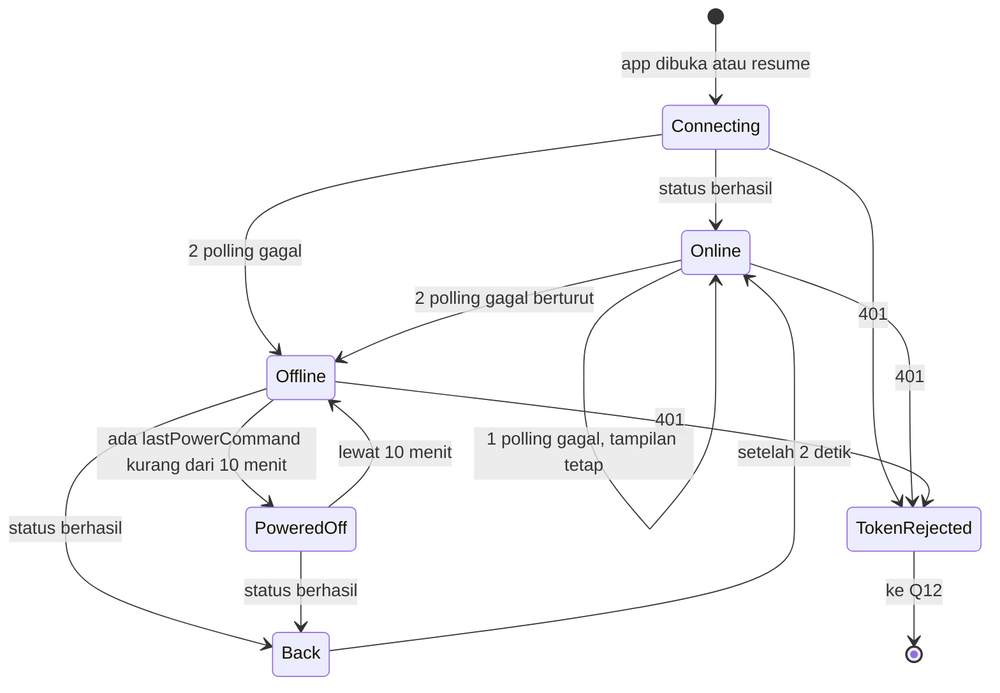
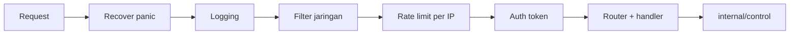

# Technical Spec — Remotto

Status dokumen: **draft Gate 2**. Aturan bisnis `BR-n` dan requirement `FR-n` ada di `docs/prd.md`. Format data ada di `docs/data-design.md`. Detail endpoint ada di `docs/api-spec.md`. Detail visual ada di `docs/design-system.md`.

## 1. Arsitektur

Dua komponen, tanpa server dan tanpa cloud:

- **Agent:** satu binary `remotto-agent.exe` di laptop Windows, jalan di sesi user.
- **App:** Flutter untuk Android dan iOS.

Keduanya berkomunikasi lewat HTTP JSON di LAN, base path `/api/v1`, port default 8765. Diagram ada di `docs/flows/system-architecture.md`.

**Polling, bukan WebSocket (final).** Status dibaca lewat `GET /status` setiap 5 detik. Polling sekaligus menjadi deteksi offline, mudah ditest, dan tidak butuh manajemen sambungan. Hitung mundur daya tidak butuh push karena app memakai `remainingMs`. WebSocket tetap di backlog, dan `GET /ws` tidak dibuat.

## 2. Versi toolchain

| Alat | Versi | Catatan |
|---|---|---|
| Go | 1.27 | `go.mod` memakai rilis stabil terbaru. Laptop dev masih 1.25.5, jadi perlu upgrade atau `GOTOOLCHAIN=auto` |
| Flutter | 3.47 stable, Dart 3.13 | Sudah terpasang di laptop dev |

## 3. Struktur folder agent

```text
agent/
  cmd/agent/          entry, subcommand, perakitan dependency
  internal/server/    router, middleware, handler
  internal/control/   domain: media, volume, power, scheduler, interface OS
  internal/oswin/     implementasi Windows (file _windows.go)
  internal/oscontrol/fake/   implementasi palsu untuk test
  internal/config/    baca, tulis, migrasi, izin file
  internal/pairing/   token, pemilihan host, payload dan render QR
  internal/logging/   slog + rotasi file
  internal/startup/   Task Scheduler (install, uninstall)
  internal/discovery/ iklan mDNS, filter interface LAN (M7)
```

Subcommand: `run`, `pair`, `reset-token`, `install-startup`, `uninstall-startup`, `version`.

Aturan dependency:

- `internal/control` hanya mendefinisikan interface `MediaController`, `AudioController`, `PowerController` dan tidak mengimpor `oswin`.
- Perakitan implementasi hanya di `cmd/agent`: file `_windows.go` memakai `oswin`, file lain memakai stub yang membalas error, supaya `go vet` dan test logika jalan di OS mana pun.
- `internal/server` hanya memanggil `internal/control`.

## 4. Struktur folder app

```text
app/lib/
  main.dart
  core/
    theme/     token hasil generate, ThemeData, ThemeExtension
    router/    go_router dan redirect
    network/   klien HTTP, tipe error, envelope respons
    storage/   secure storage dan preferences
    connection/  controller polling dan state koneksi
    discovery/   pencarian mDNS dan validasi kandidat (M7)
    strings/   semua teks UI
    haptics/   pembungkus haptic yang patuh preferensi
  features/
    pairing/   data, state, widgets
    remote/    data, state, widgets
    power/     data, state, widgets
    settings/  data, state, widgets
  ui/          primitif kustom (lihat docs/design-system.md)
app/tool/      generator token
app/test/      unit, widget, golden
```

### Package

| Kebutuhan | Package | Alasan | Lisensi |
|---|---|---|---|
| State | `flutter_riverpod` (tanpa codegen) | Mudah di-override untuk mock dan test; fase Frontend ke Integrasi cukup mengganti provider | MIT |
| HTTP | `http` | Cukup untuk JSON + timeout per request; `MockClient` sudah tersedia. `dio` ditolak karena fiturnya tidak terpakai | BSD-3 |
| Navigasi | `go_router` | Redirect global untuk token ditolak dan penggantian stack; transisi bisa dikustom | BSD-3 |
| QR | `mobile_scanner` | Sesuai brief | BSD-3 |
| Izin | `permission_handler` | Q02 butuh status izin sebelum dialog OS, Q05 butuh deteksi ditolak permanen dan buka pengaturan HP | MIT |
| Token | `flutter_secure_storage` | Sesuai brief | BSD-3 |
| Preferensi | `shared_preferences` | Sesuai brief | BSD-3 |
| Layar tetap nyala | `wakelock_plus` | Kebutuhan C13 | BSD-3 |
| Versi app | `package_info_plus` | Baris Versi di SCR-020 | BSD-3 |
| Discovery agent | `nsd` | Resolve `_remotto._tcp` lewat Bonjour (iOS) dan NsdManager (Android), D1/D8 | MIT |
| Pemicu jaringan | `connectivity_plus` | Event perubahan WiFi/Ethernet untuk rediscover, D6 | BSD-3 |

Semuanya fungsional dan non-visual, sehingga sesuai §11. Haptic memakai `HapticFeedback` bawaan Flutter.

### Pola state

- Riverpod: `Notifier` per fitur, repository sebagai provider.
- Setiap fitur punya interface repository dengan dua implementasi: mock dan HTTP. Mock mengembalikan bentuk respons persis `docs/api-spec.md`, termasuk error.
- Widget tidak memanggil HTTP dan tidak membaca storage secara langsung.
- `ConnectionController` di `core/connection` menjadi satu-satunya sumber status koneksi.

## 5. Mesin status koneksi

Controller memegang polling, menentukan state untuk SCR-010, dan memicu layar daya saat ada `pending`.



Aturan:

- Paling banyak satu polling berjalan. Tick berikutnya dilewati kalau yang sebelumnya belum selesai.
- Polling berhenti saat app di background. Saat dibuka atau resume, polling langsung jalan dengan timeout 2 detik dan layar S02 (BR-21).
- Timeout polling biasa 3 detik.
- Rediscover (M7) dipicu saat poll gagal non-401, saat jaringan WiFi/Ethernet berubah (debounce 1 detik), dan saat resume. Selama offline, paling sering sekali per 15 detik. Timeout satu sesi discovery 3 detik. Aturan lengkapnya ada di `docs/flows/discovery-flow.md`. Tidak ada fase koneksi baru.
- Setelah restart terkirim, interval menjadi 2 detik sampai tersambung lagi.
- Setiap respons `/status` memperbarui volume, kecuali saat slider ditarik (FR-3.7).
- `pending` terdeteksi saat app dibuka atau resume memicu P13 atau P14 (FR-4.9, FR-4.10). `pending` yang muncul saat app sudah di Remote, misalnya dari HP lain, diperlakukan sama.

## 6. Perilaku perintah di app

| Jenis | Retry otomatis | Timeout | Gagal |
|---|---|---|---|
| Media | Tidak, agar lagu tidak terlewat dua kali | 3 detik | Ikon kembali + toast "Ulangi" |
| Slider (`PUT /volume`) | 1 kali diam-diam, idempoten | 3 detik | Rollback ke nilai laptop + toast |
| −/+ | Tidak, tidak idempoten | 3 detik | Toast "Ulangi" |
| Mute | 1 kali diam-diam, idempoten | 3 detik | Rollback + toast |
| Jadwalkan daya | Tidak | 3 detik | Lihat di bawah |
| Batal daya | Oleh pengguna ("Batal lagi") | 3 detik | P11 |

**Slider:** paling banyak satu `PUT` berjalan. Selama menunggu, hanya nilai terbaru yang disimpan lalu dikirim setelah 100 ms berlalu dan request sebelumnya selesai. Ini mencegah request menumpuk di WiFi lambat, dan nilai akhir selalu terkirim.

**Gagal saat menjadwalkan daya:** P10 berbunyi "Laptop masih nyala", jadi layar itu hanya boleh tampil kalau kebenarannya terjamin. App tidak pernah mengulang otomatis.

| Kejadian | Artinya | Tindakan |
|---|---|---|
| Gagal tersambung, request belum terkirim | Perintah pasti tidak sampai | P10 |
| Respons error dari agent | Perintah ditolak | P10 |
| Timeout setelah request terkirim | Ambigu, perintah mungkin sudah sampai | Baca `/status` |
| `/status` berisi `pending` | Perintah sampai | Lanjut hitung mundur dari sisa waktu |
| `/status` berhasil tanpa `pending` | Perintah tidak sampai | P10 |
| `/status` juga gagal | Masih ambigu | P11 dengan "Batal lagi", dimulai dari jeda penuh |

P11 dipakai untuk kasus terakhir karena teksnya jujur ("Kalau tetap gagal, laptop bakal mati"). Menampilkan P10 di sini bisa berbohong dan membuat laptop mati tanpa peringatan.

**Hasil batal:**

| Respons | Layar |
|---|---|
| 200 | P08 + toast |
| 409 `no_pending_power` | P08, jadwal sudah tidak ada |
| 409 `power_executing` | P14 |
| Timeout atau tidak terjangkau | P11 |

## 7. Integrasi OS (agent)

Agent wajib jalan di sesi user interaktif. Windows Service jalan di session 0 dan tidak bisa mengirim input ke sesi user.

### Media

- `SendInput` dipanggil lewat `user32.dll` memakai `windows.NewLazySystemDLL`, karena `x/sys/windows` tidak membungkusnya.
- Satu perintah berupa key down + key up dengan `KEYEVENTF_EXTENDEDKEY`.
- Kode: `VK_MEDIA_PLAY_PAUSE` 0xB3, `VK_MEDIA_NEXT_TRACK` 0xB0, `VK_MEDIA_PREV_TRACK` 0xB1.
- `SendInput` mengembalikan 0 → error `media_failed`.
- `SendInput` tidak bekerja saat layar terkunci. Lihat R-16 di PRD.

`VK_VOLUME_*` tidak dipakai (keputusan S-3).

### Volume

- Memakai `github.com/moutend/go-wca` + `github.com/go-ole/go-ole`, tanpa CGO.
- COM diinisialisasi di satu goroutine pekerja dengan `runtime.LockOSThread`. Semua operasi audio lewat channel ke goroutine ini dengan batas 1 detik.
- Endpoint default diambil ulang di setiap operasi, sehingga agent mengikuti perpindahan ke headset.
- Level dipetakan ke `SetMasterVolumeLevelScalar` (0–100 ↔ 0,0–1,0) dan dibulatkan saat dibaca.
- Pekerja menginisialisasi ulang COM setelah error, sehingga satu kegagalan tidak mematikan fitur volume.
- `go-wca` terakhir dirilis 2023. Risikonya dibatasi karena hanya dipakai di balik `AudioController`.

Setiap perubahan level (`PUT`, naik, turun) sekaligus mematikan mute. Ini memenuhi BR-15 dan menyamakan −/+ dengan tombol volume fisik.

### Daya

Jeda dipegang scheduler di agent, jadi perintah OS selalu tanpa jeda. `shutdown /a` tidak diperlukan: batal cukup menghentikan timer.

| Aksi | Implementasi |
|---|---|
| Shutdown | `shutdown /s /t 0` tanpa `/f` |
| Restart | `shutdown /r /t 0` tanpa `/f` |
| Sleep | Bergantung kemampuan laptop, lihat di bawah |

`/f` tidak dipakai agar aplikasi dengan pekerjaan belum tersimpan tidak ditutup paksa. Konsekuensinya, Windows bisa berhenti di layar "app menghalangi shutdown" (R-15).

**Sleep.** Laptop pengembangan hanya mendukung Modern Standby (S0 Low Power Idle, Network Connected), tanpa S3. Di perangkat seperti ini `SetSuspendState` tidak bisa menjadi jalur tunggal, karena perilakunya bisa berubah menjadi hibernate atau gagal. Agent menentukan cara saat runtime lewat `GetPwrCapabilities`:

| Kemampuan | Cara sleep |
|---|---|
| S0 Low Power Idle (`AoAc`) | Mematikan layar dengan `SC_MONITORPOWER`, lalu Windows masuk Modern Standby |
| S3 | `SetSuspendState(FALSE, FALSE, FALSE)` setelah mengaktifkan `SE_SHUTDOWN_NAME` |

Saran `powercfg -h off` hanya berlaku untuk jalur S3. Di laptop S0, perintah itu tidak dibutuhkan dan ikut mematikan Fast Startup. Perilaku nyata dicek pemilik lewat `waiting.md` (R-17).

### Scheduler daya

- Berada di `internal/control`, dengan clock yang bisa disuntikkan untuk test.
- State: kosong → terjadwal → mengeksekusi → kosong.
- Dilindungi mutex. Satu jadwal aktif (BR-5).
- Timer berjalan di goroutine sendiri, jadi handler langsung membalas 202.
- Perintah OS dijalankan di luar lock agar `/status` tetap merespons.
- Saat mengeksekusi, `pending` tampil dengan `remainingMs: 0`. Dibersihkan saat pemanggilan OS kembali.
- Graceful shutdown agent membuang jadwal.

### Uptime

`uptimeSeconds` adalah lama proses agent berjalan, bukan `GetTickCount64`. Dengan Fast Startup aktif, uptime sistem tidak ter-reset saat laptop dimatikan, sehingga angkanya bisa berhari-hari dan membingungkan di "Nyala sejak". Karena agent mulai saat login, nilainya mendekati lama laptop dipakai.

### Startup

- `install-startup` membuat task `Remotto\Agent` lewat `schtasks /Create /XML` dengan trigger "At log on" untuk user saat ini, `LogonType` InteractiveToken, dan `RunLevel` LeastPrivilege.
- Task menjalankan `remotto-agent.exe run --background`.
- `run --background` memanggil `FreeConsole` di awal dan hanya menulis log ke file. Jendela konsol bisa berkedip sekali saat login. Alternatif build `-H=windowsgui` ditolak karena merusak output `pair` di terminal.
- Membuat task bisa membutuhkan terminal Administrator; hal ini dicatat di `docs/release.md`. Task tetap jalan tanpa hak admin.
- Satu instance lewat named mutex `Local\RemottoAgent`.

## 8. Auth & pairing

- Token: 32 byte dari `crypto/rand`, disimpan sebagai 64 karakter hex.
- Header: `Authorization: Bearer <token>`.
- Perbandingan: `subtle.ConstantTimeCompare`.
- Token dimuat ulang saat waktu modifikasi `config.json` berubah (BR-10).
- Tanpa refresh token dan tanpa masa berlaku. Reset lewat `reset-token`.
- `pair` membaca config, memilih host, lalu menampilkan QR lewat `github.com/mdp/qrterminal/v3` beserta teksnya. Perintah ini tidak butuh agent sedang jalan dan tidak mengubah token.
- Opsi `pair --host <ip>` untuk override, misalnya IP Tailscale.

## 9. Pipeline request

Middleware dipasang di luar router, sehingga rute tidak dikenal pun ikut terlindungi. Urutannya:



- **Filter jaringan:** menolak alamat sumber di luar rentang privat, loopback, dan `100.64.0.0/10` dengan 403. Ini pertahanan kedua kalau firewall salah konfigurasi.
- **Rate limit:** token bucket per IP, default 20 per detik dan burst 40. Slider mengirim paling banyak 10 per detik, jadi tidak tersandung.
- **Body:** dibatasi 1 KiB, JSON ketat, field tak dikenal ditolak.
- **CORS:** tidak ada. Bearer token tidak terkirim otomatis oleh browser, sehingga halaman web tidak bisa memicu perintah.

| Timeout server | Nilai |
|---|---|
| Read header | 2 detik |
| Read | 3 detik |
| Write | 5 detik |
| Idle | 60 detik, agar sambungan bisa dipakai ulang saat slider ditarik |

**Graceful shutdown:** saat Ctrl+C atau sinyal berhenti, server berhenti menerima request, request berjalan diberi waktu 3 detik, jadwal daya dibuang, lalu proses keluar.

## 10. Logging & error

- `log/slog` JSON ke file. Saat `run` interaktif, juga ke konsol.
- Field dan larangan ada di `docs/data-design.md`.
- Error OS dibungkus menjadi error domain. Detail teknis hanya masuk log, respons memakai pesan aman.
- Panic di handler ditangkap dan menjadi 500 `internal`.

## 11. Jaringan

- **Bind:** `0.0.0.0` (final). Mengikat ke satu IP LAN akan rusak saat DHCP mengganti IP, dan menyulitkan Tailscale. Pembatasnya adalah firewall profil Private, filter jaringan, dan token.
- **Firewall:** aturan masuk untuk profil Private: TCP port agent, dan UDP 5353 (mDNS) untuk program agent. Tanpa aturan UDP 5353, discovery tidak jalan dan app kembali ke scan QR ulang. Panduan ada di `docs/release.md`.
- **IP berubah:** app me-resolve ulang laptop lewat mDNS (`_remotto._tcp`), sehingga tidak perlu scan QR ulang. Detail alur ada di `docs/flows/discovery-flow.md`. Scan QR tetap cadangan bila discovery gagal. Saran DHCP reservation tetap berlaku.
- **Discovery di agent:** library `github.com/grandcat/zeroconf` (fallback `github.com/libp2p/zeroconf/v2`). Iklan hanya di interface privat yang aktif, dengan daftar ulang saat alamat berubah. Port tidak pernah berubah, hanya IP.
- **Discovery di app:** library `nsd` (Bonjour dan NsdManager) dan `connectivity_plus` untuk pemicu perubahan jaringan. Hasil discovery hanya disimpan setelah verifikasi `GET /status` (aturan D5 di `docs/prd.md`, BR-22).
- **Tailscale:** pairing memakai IP Tailscale lewat `pair --host`. Tanpa perubahan kode. Discovery tidak mengiklankan alamat Tailscale.

### Konfigurasi platform app

| Platform | Konfigurasi |
|---|---|
| Android | `INTERNET` + `CAMERA`; cleartext diizinkan lewat network security config karena tidak bisa dibatasi per rentang IP, jadi BR-12 ditegakkan oleh validasi app; `allowBackup=false`; `CHANGE_WIFI_MULTICAST_STATE` (diminta README `nsd`); `ACCESS_NETWORK_STATE` datang dari manifest plugin `connectivity_plus` |
| iOS | `NSCameraUsageDescription`, `NSLocalNetworkUsageDescription`, `NSAllowsLocalNetworking`; `NSBonjourServices` berisi `_remotto._tcp`; dicek saat build di Mac |

## 12. Strategi testing

**Agent**

- Unit test domain dengan fake OS: scheduler (jeda, cancel, jadwal kedua, eksekusi gagal) memakai clock palsu, batas volume, unmute saat level berubah.
- Handler test (`httptest`): auth, validasi, kode error, format respons.
- Satu test menelusuri semua route dan memastikan semuanya menolak tanpa token (G-7).
- Test config: migrasi, file rusak, tulis atomik, deteksi perubahan token.
- Test integrasi OS diberi build tag `manual` dan tidak dijalankan di CI. Efek nyata tidak pernah dijalankan otomatis.

**App**

- Unit test state dan repository dengan `MockClient`.
- Unit test mesin status koneksi dan validator payload QR.
- Widget test semua primitif `lib/ui/`, termasuk Semantics.
- Golden test opsional untuk komponen utama, terang dan gelap.

## 13. Pipeline CI

Job `agent-test` (windows-latest), `app-test` (ubuntu-latest), dan `build` (hanya `main`). Detail ada di `docs/release.md`.

`.gitattributes` memakai `eol=lf`, karena checkout di runner Windows bisa mengubah akhir baris dan membuat cek `gofmt` gagal.

## 14. Lingkungan

Development lokal native dengan Go dan Flutter SDK. Tidak ada staging, production server, atau Docker (§12).

## 15. Security checklist

- [ ] Semua route melewati auth; tidak ada pengecualian
- [ ] Token 256 bit dari `crypto/rand`, compare constant-time
- [ ] Token tidak ada di log, respons API, atau pesan error
- [ ] Rate limit aktif per IP
- [ ] Filter jaringan aktif, firewall hanya profil Private
- [ ] Input divalidasi: level, ukuran body, field JSON
- [ ] DACL config diperiksa saat start
- [ ] Payload QR dan input manual divalidasi sebagai input tidak tepercaya
- [ ] Hasil discovery mDNS hanya disimpan bila `agentId` cocok dan `GET /status` dengan token tersimpan mengembalikan 200 (BR-22)
- [ ] TXT mDNS tidak pernah berisi token atau hash token
- [ ] App menyimpan token hanya di secure storage; backup Android mati
- [ ] `govulncheck` jalan di CI
- [ ] Tidak ada port-forward; akses luar hanya lewat Tailscale

## 16. Theming & arsitektur widget

- `design/tokens.json` adalah sumber nilai. `app/tool/generate_tokens.dart` menghasilkan `lib/core/theme/tokens.g.dart`, dan file hasil generate ikut di-commit agar CI tidak bergantung pada `design/`.
- Warna standar dipetakan ke `ColorScheme`, sisanya ke `ThemeExtension`. Spacing, radius, ukuran, durasi, dan kurva menjadi konstanta.
- `ThemeMode` berasal dari preferensi, default sistem.
- Widget fitur dilarang hardcode warna dan ukuran.
- Primitif visual ada di `lib/ui/`. Widget fitur hanya menyusun primitif dan tidak membuat gaya sendiri.
- Variant dibuat lewat enum dan parameter pada primitif, tanpa UI kit (§11).
- Material hanya basis teknis. `ripple`, `surfaceTint`, dan widget default dimatikan atau tidak dipakai.

Detail ada di `docs/design-system.md`.
